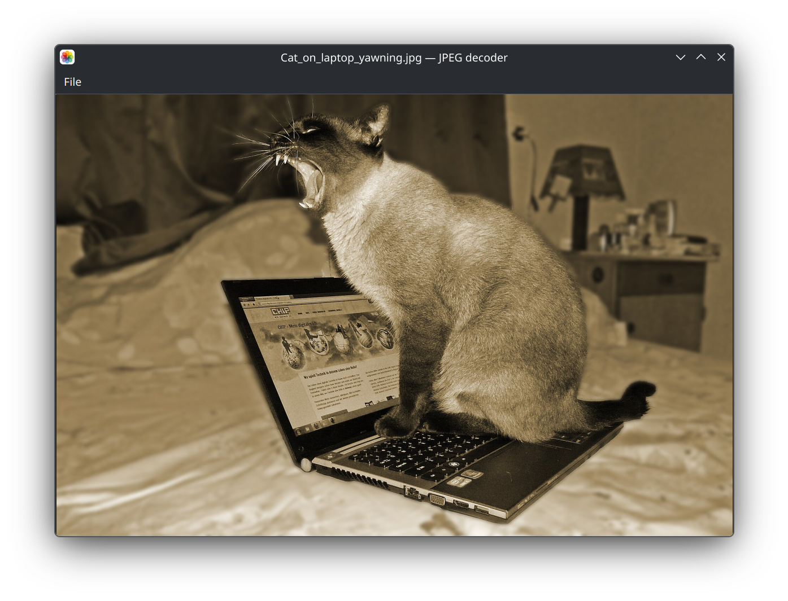

## Пример работы


## Сборка
Зависимости:
```bash
sudo apt install qt6-base-dev libfftw3-dev
```
или
```bash
sudo pacman -S qt6-base fftw
```

Сборка приложения:
```bash
cmake -B build -DCMAKE_BUILD_TYPE=Release
cmake --build build
```

## Запуск
Открыть изображение можно через **File -> Open** или передать путь аргументом командной строки:
```bash
./build/jpeg-decoder docs/cat.jpg
```

## Тесты
Дополнительные зависимости:
```bash
sudo apt install libjpeg-dev libpng-dev
```
или
```bash
sudo pacman -S libjpeg-turbo libpng
```

Сборка и запуск тестов:
```bash
cmake -B build -DCMAKE_BUILD_TYPE=Release -DBUILD_TESTING=ON
cmake --build build
./build/test_baseline
```
